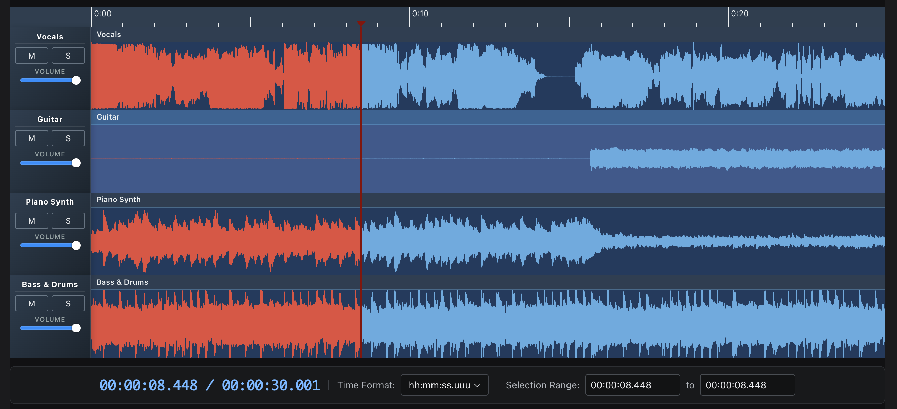

# Waveform Playlist

A multi-track audio editor and player built with React, Tone.js, and the Web Audio API. Features canvas-based waveform visualization, drag-and-drop clip editing, and professional audio effects.

<p align="center">
  
</p>

<p align="center">
  <a href="https://discord.gg/dsZZBpmD7k"></a>
</p>

## Features

- **Multi-track editing** - Multiple clips per track with drag-to-move and trim
- **Waveform visualization** - Canvas-based rendering with zoom controls
- **20+ audio effects** - Reverb, delay, filters, distortion, and more via Tone.js
- **Recording** - AudioWorklet-based recording with live waveform preview
- **Export** - WAV export with effects, individual tracks or full mix
- **Annotations** - Time-synced text annotations with keyboard navigation
- **Theming** - Full theme customization with dark/light mode support
- **MIDI playback** - MIDI file parsing with piano roll visualization and SoundFont sample playback
- **TypeScript** - Full type definitions included

## Stable and next

Waveform Playlist is published on two lines:

| Line | npm tag | Docs and examples | Branch |
|------|---------|-------------------|--------|
| **Stable** | `latest` | [naomiaro.github.io/waveform-playlist](https://naomiaro.github.io/waveform-playlist/) | [`main`](https://github.com/naomiaro/waveform-playlist/tree/main) |
| **Next** | `next`: prereleases | [naomiaro.github.io/waveform-playlist/next](https://naomiaro.github.io/waveform-playlist/next/) | [`dev`](https://github.com/naomiaro/waveform-playlist/tree/dev) |

**This README describes next**, the code on `dev`, and its links go to the next docs. The stable release's README is [on `main`](https://github.com/naomiaro/waveform-playlist/blob/main/README.md). To move a project from stable to next, see the [upgrade guide](https://naomiaro.github.io/waveform-playlist/next/docs/react/upgrading).

## Install

Stable:

```bash
npm install @waveform-playlist/browser @waveform-playlist/playout @waveform-playlist/core tone @dnd-kit/react
```

Next:

```bash
npm install @waveform-playlist/browser@next @waveform-playlist/playout@next @waveform-playlist/core@next tone @dnd-kit/react
```

`tone`, `@waveform-playlist/playout` (the Tone.js engine) and `@dnd-kit/react` are peer dependencies of `browser`. `@waveform-playlist/core` is listed because your own code imports from it.

**On next, add `@next` to every `@waveform-playlist/*` and `@dawcore/*` package you install,** not only the ones above. A `latest` package beside `@next` ones can fail their peer ranges (`annotations@latest` peers on `browser ^16`). The commands in the next docs carry the tag already.

**React:** next requires React 19.

Without the Tone.js engine (on next, npm installs neither `@waveform-playlist/playout` nor `tone`; on stable it still installs both, through `ui-components`, though nothing in your bundle imports them):

- MediaElement playout: `npm install @waveform-playlist/browser @waveform-playlist/media-element-playout @dnd-kit/react`
- Your own adapter: `npm install @waveform-playlist/browser @waveform-playlist/engine @dnd-kit/react` (`engine` for the `PlayoutAdapter` type), and pass `createAdapter` to the provider

With esbuild, mark the engines you did not install as external (`--external:@waveform-playlist/playout`, and with your own adapter also `--external:@waveform-playlist/media-element-playout`): `browser`'s build imports both, and esbuild resolves them even when your app never uses them ([#892](https://github.com/naomiaro/waveform-playlist/issues/892)). Vite needs nothing.

The optional packages are listed under [Packages](#packages); [Installation](https://naomiaro.github.io/waveform-playlist/next/docs/react/getting-started/installation) has the setup for annotations, recording and spectrogram.

## Quick Start

```tsx
import {
  WaveformPlaylistProvider,
  Waveform,
  PlayButton,
  PauseButton,
  StopButton,
  useCreateArrangement,
} from '@waveform-playlist/browser';
import { audioTrack } from '@waveform-playlist/core';

function App() {
  // The arrangement owns the tracks; it fetches and decodes the file once the provider has its audio context
  const arrangement = useCreateArrangement(() => [audioTrack({ src: '/audio/song.mp3', name: 'My Track' })]);

  return (
    <WaveformPlaylistProvider arrangement={arrangement}>
      <div>
        <PlayButton />
        <PauseButton />
        <StopButton />
      </div>
      <Waveform />
    </WaveformPlaylistProvider>
  );
}
```

This is the next API. The stable equivalent is in the [stable Getting Started](https://naomiaro.github.io/waveform-playlist/docs/react/getting-started/basic-usage); on stable, import `useAudioTracks` from `@waveform-playlist/browser/tone` (the page says `@waveform-playlist/browser`, [#887](https://github.com/naomiaro/waveform-playlist/issues/887)).

## Documentation

- [**Live Examples**](https://naomiaro.github.io/waveform-playlist/next/examples/stem-tracks) - Interactive demos
- [**Getting Started**](https://naomiaro.github.io/waveform-playlist/next/docs/react/getting-started/installation) - Installation and basic usage
- [**Guides**](https://naomiaro.github.io/waveform-playlist/next/docs/react/guides/loading-audio) - In-depth tutorials
- [**API Reference**](https://naomiaro.github.io/waveform-playlist/next/docs/react/api/components) - Component and hook documentation
- [**Upgrade guide**](https://naomiaro.github.io/waveform-playlist/next/docs/react/upgrading) - From stable to next, one section per change

## Community

- [**Discord**](https://discord.gg/dsZZBpmD7k) - Chat, get help, and share what you're building on the dawcore server
- [**Issues**](https://github.com/naomiaro/waveform-playlist/issues) - Bug reports and feature requests
- [**Code of Conduct**](CODE_OF_CONDUCT.md) - The standards we hold this community to, on GitHub and Discord

## Examples

| Example | Description |
|---------|-------------|
| [Minimal](https://naomiaro.github.io/waveform-playlist/next/examples/minimal) | One track and the transport buttons |
| [New Tracks](https://naomiaro.github.io/waveform-playlist/next/examples/newtracks) | Drop audio files to add tracks; remove them again |
| [Stem Tracks](https://naomiaro.github.io/waveform-playlist/next/examples/stem-tracks) | Multi-track playback with mute/solo/volume controls |
| [Effects](https://naomiaro.github.io/waveform-playlist/next/examples/effects) | 20 Tone.js effects with real-time parameter control |
| [WAM! Kick It Up a Notch](https://naomiaro.github.io/waveform-playlist/next/examples/wam-effects) | Host WAM 2.0 plugins with community library, native GUIs, and mixed Tone+WAM chains |
| [Recording](https://naomiaro.github.io/waveform-playlist/next/examples/recording) | Live recording with VU meter and waveform preview |
| [Multi-Clip](https://naomiaro.github.io/waveform-playlist/next/examples/multi-clip) | Drag-and-drop clip editing with trim handles |
| [Custom Drag Setup](https://naomiaro.github.io/waveform-playlist/next/examples/custom-drag-setup) | The same clip editing with your own `DragDropProvider` and `ClipInteractionOptions` |
| [Annotations](https://naomiaro.github.io/waveform-playlist/next/examples/annotations) | Time-synced text with keyboard navigation |
| [Waveform Data](https://naomiaro.github.io/waveform-playlist/next/examples/waveform-data) | Pre-computed peaks for fast loading |
| [MIDI](https://naomiaro.github.io/waveform-playlist/next/examples/midi) | MIDI file playback with piano roll and SoundFont samples |
| [Beats & Bars](https://naomiaro.github.io/waveform-playlist/next/examples/beats-and-bars) | Tempo-synced timescale with beats and bars ruler |
| [Fades](https://naomiaro.github.io/waveform-playlist/next/examples/fades) | Fade in/out with configurable curves |
| [Stereo](https://naomiaro.github.io/waveform-playlist/next/examples/stereo) | Stereo waveform rendering and pan controls |
| [Spectrogram](https://naomiaro.github.io/waveform-playlist/next/examples/mir-spectrogram) | FFT-based spectrogram visualization |
| [Media Element](https://naomiaro.github.io/waveform-playlist/next/examples/media-element) | HTMLMediaElement playout with playback rate; `?t=8` puts the first player's cursor at 8 seconds |
| [Media Element Annotations](https://naomiaro.github.io/waveform-playlist/next/examples/media-element-annotations) | Time-synced annotations on streamed audio with pre-computed peaks |
| [Styling](https://naomiaro.github.io/waveform-playlist/next/examples/styling) | Bar width, gaps, rounded bars, gradients, and theme colors |
| [Flexible API](https://naomiaro.github.io/waveform-playlist/next/examples/flexible-api) | Custom playheads, timestamps, and full UI customization |
| [Mobile Multi-Clip](https://naomiaro.github.io/waveform-playlist/next/examples/mobile-multi-clip) | Clip editing with touch: hold to drag |
| [Mobile Annotations](https://naomiaro.github.io/waveform-playlist/next/examples/mobile-annotations) | Annotations with touch: tap to play, hold to resize |
| [Web Components — Basic](https://naomiaro.github.io/waveform-playlist/next/examples/wc-basic) | Minimal `<daw-editor>` on the native Web Audio backend, no React in the audio path |
| [Web Components — Multiclip](https://naomiaro.github.io/waveform-playlist/next/examples/wc-multiclip) | Multiple clips per track with drag, trim, split and pre-computed peaks via `<daw-clip>` |
| [Web Components — Player](https://naomiaro.github.io/waveform-playlist/next/examples/wc-player) | Lightweight `<daw-player>` single-track player: HTMLMediaElement streaming, pre-computed peaks, no Tone.js |

## Packages

| Package | Description |
|---------|-------------|
| `@waveform-playlist/browser` | Main React components, hooks, and context |
| `@waveform-playlist/core` | Types, utilities, and clip/track creation |
| `@waveform-playlist/engine` | Framework-agnostic timeline engine with pure operations |
| `@waveform-playlist/ui-components` | Styled UI components (buttons, sliders, etc.) |
| `@waveform-playlist/playout` | Tone.js audio engine |
| `@waveform-playlist/webaudio-peaks` | Peak extraction from AudioBuffer or sample arrays |

**Optional packages:**

| Package | Description |
|---------|-------------|
| `@waveform-playlist/midi` | The `loadMidiTracks` function: a `.mid` file as MIDI tracks for the arrangement, drawn as piano rolls and played with SoundFont or PolySynth. Re-exports the parser from `@dawcore/midi`. |
| `@waveform-playlist/annotations` | Time-synced text annotations with drag editing |
| `@waveform-playlist/recording` | AudioWorklet recording with live waveform preview (requires [setup](https://naomiaro.github.io/waveform-playlist/next/docs/react/guides/recording#audioworklet-setup)) |
| `@waveform-playlist/worklets` | Shared AudioWorklet processors for metering and recording (auto-installed with recording) |
| `@waveform-playlist/spectrogram` | React `SpectrogramProvider` + UI (menu items, settings modal). Computation/worker/orchestrator are imported from `@dawcore/spectrogram`. |
| `@waveform-playlist/media-element-playout` | HTMLMediaElement-based playout with pitch-preserving playback rate |

## Key Hooks

```tsx
// The arrangement owns the tracks and loads their audio: pass it to <WaveformPlaylistProvider arrangement>
const arrangement = useCreateArrangement(() => [
  audioTrack({ src: '/audio/vocals.mp3', name: 'Vocals' }),
  audioTrack({ src: '/audio/drums.mp3', name: 'Drums' }),
]);

// Where each file is (pending, loaded, failed), and arrangement.retry(src)
const { pendingCount, failedCount } = useArrangementSources(arrangement);

// Add a dropped file (below the provider, useArrangement() returns the same arrangement)
arrangement.addTrack(audioTrack({ src: file }));

// Playback controls
const { play, pause, stop, seekTo } = usePlaybackControls();

// Playback state, refs and per-frame callbacks for 60fps UI
const { isPlaying } = useIsPlaying();
const { currentTimeRef } = usePlaybackRefs();

// Where the cursor rests (changes on seek, pause and stop)
const { currentTime } = useCurrentTime();

// Zoom controls, and the zoom level (re-renders on a zoom)
const { zoomIn, zoomOut } = useEditorControls();
const { samplesPerPixel } = usePlaylistZoom();

// Master effects chain (from @waveform-playlist/browser/tone)
const { masterEffects, toggleBypass, updateParameter } = useDynamicEffects();

// WAV export (from @waveform-playlist/browser/tone)
const { exportWav, isExporting, progress } = useExportWav();

// Recording (from @waveform-playlist/recording): the take is added to the arrangement's track (one undo step)
const { startRecording, stopRecording, isRecording } = useIntegratedRecording(
  arrangement, selectedTrackId
);
```

## Web Components (Experimental)

`@dawcore/components` provides framework-agnostic Web Components for multi-track audio editing — no React required. Built with Lit, adapter-pluggable: choose between `@dawcore/transport` (native Web Audio) or `@waveform-playlist/playout` (Tone.js).

On next, add `@next` to each of these packages, as above.

```bash
npm install @dawcore/components @waveform-playlist/core @waveform-playlist/engine
```

Audio backend (choose one):
```bash
npm install @dawcore/transport          # Native Web Audio (multi-tempo, multi-meter, metronome)
# or
npm install @waveform-playlist/playout tone  # Tone.js (effects, MIDI synths)
```

```html
<script type="module">
  import '@dawcore/components';
  import { NativePlayoutAdapter } from '@dawcore/transport';

  const editor = document.querySelector('daw-editor');
  const adapter = new NativePlayoutAdapter(new AudioContext());
  editor.adapter = adapter;
</script>

<daw-editor id="editor" clip-headers interactive-clips timescale>
  <daw-track name="Vocals">
    <daw-clip src="/audio/vocals.mp3" start="0" duration="10"></daw-clip>
  </daw-track>
  <daw-keyboard-shortcuts playback splitting undo></daw-keyboard-shortcuts>
</daw-editor>

<daw-transport for="editor">
  <daw-play-button></daw-play-button>
  <daw-pause-button></daw-pause-button>
  <daw-stop-button></daw-stop-button>
  <daw-record-button></daw-record-button>
</daw-transport>
```

**Features:**
- Declarative `<daw-track>` and `<daw-clip>` elements with auto-loading
- Imperative API for programmatic mutation — `editor.addTrack/removeTrack/updateTrack/addClip/removeClip/updateClip` and `editor.ready()` for engine bootstrap before any track loads
- Adapter-pluggable — choose Native Web Audio or Tone.js backend
- Clip move, trim, and split with collision detection
- Undo/redo with transaction-based grouping
- Keyboard shortcuts (Space=play/pause, S=split, Cmd/Ctrl+Z=undo)
- File drop for adding tracks
- Frozen-panes layout — height-constrained editors scroll vertically with a pinned ruler and row-locked track controls; controls adapt to short rows
- Recording with overdub, punch-in replace (takes land at the playhead and replace overlapped content), automatic armed-track mute (the recorded-over material is silenced during the take), named takes with live clip headers, and latency compensation
- Metronome with mixed meters and tempo changes
- Tempo automation — linear ramps and Möbius-Ease curves with exact integration
- Pre-computed peaks for fast initial render
- Player-style end-of-timeline auto-stop by default; `indefinite-playback` rolls DAW-style until an explicit stop, `fill-viewport` fills the empty viewport so the ruler renders before any track (recording sessions suppress the auto-stop automatically)

**Packages:**

| Package | Description |
|---------|-------------|
| `@dawcore/components` | Lit Web Components for multi-track editing |
| `@dawcore/transport` | Native Web Audio transport — scheduling, looping, tempo automation, time signatures, metronome |
| `@dawcore/spectrogram` | Framework-agnostic spectrogram orchestrator, FFT worker pool, and color maps — used by `render-mode="spectrogram"` |
| `@dawcore/midi` | Framework-agnostic MIDI parser (`parseMidiFile`, `parseMidiUrl`) — used by `editor.loadMidi()` and re-exported by `@waveform-playlist/midi` |
| `@dawcore/wam` | Web Audio Modules (WAM 2.0) plugin hosting and generic parameter GUIs — used by `editor.addWamPlugin()` and the effects chain (optional peer, loaded on demand) |
| `@dawcore/faust` | In-browser Faust DSP → WAM 2.0 compilation — used by `editor.addFaustEffect()` (optional peer, loaded on demand) |

Run the examples locally:

```bash
pnpm example:dawcore-native  # Native Web Audio — localhost:5173
pnpm example:dawcore-tone    # Tone.js backend — localhost:5174
pnpm example:dawcore-wam     # WAM 2.0 plugins + Faust — localhost:5175
pnpm example:media-element   # MediaElement-only React starter (no Tone) — localhost:5176
pnpm example:react-starter   # Full multitrack React starter (Tone engine) — localhost:5177
```

The **[react-starter](examples/react-starter/)** is the smallest correct setup for the full
multitrack editor — `WaveformPlaylistProvider` on the default Tone.js engine with mixer
controls, plus a README section explaining the "AudioContext was prevented from starting"
browser warning and how the provider's gesture-safe startup avoids it (see its
[README](examples/react-starter/README.md)).

The **[media-element-player](examples/media-element-player/)** starter is a minimal React
single-track player using only `@waveform-playlist/browser` + `@waveform-playlist/media-element-playout`
(no `@waveform-playlist/playout`, no `tone`) — see its [README](examples/media-element-player/README.md).

**dawcore-native** example pages:

- [`basic.html`](examples/dawcore-native/basic.html) — Basic playback with timescale and file drop
- [`multiclip.html`](examples/dawcore-native/multiclip.html) — Multi-clip editing with move, trim, and split, plus drag-to-reorder tracks with a live slot-snap drop preview
- [`programmatic.html`](examples/dawcore-native/programmatic.html) — Imperative `editor.addTrack` / `addClip` / `updateClip` / `removeClip` plus declarative DOM mutation, side-by-side
- [`beats-grid.html`](examples/dawcore-native/beats-grid.html) — Beats & bars grid mode with snap-to-grid, plus bar-aligned tick-based annotation regions (`start-tick`/`end-tick`)
- [`beat-map-grid.html`](examples/dawcore-native/beat-map-grid.html) — Variable tempo from beat maps with metronome
- [`record.html`](examples/dawcore-native/record.html) — Recording with overdub
- [`metronome.html`](examples/dawcore-native/metronome.html) — Metronome with mixed meters, tempo presets, and looping sequences
- [`automation.html`](examples/dawcore-native/automation.html) — Tempo automation with step, linear, and curve presets
- [`analyser.html`](examples/dawcore-native/analyser.html) — Spectrum analyser connected to master output
- [`spectrogram.html`](examples/dawcore-native/spectrogram.html) — Per-track FFT spectrograms via `render-mode="spectrogram"` with color-map and frequency-scale controls
- [`effects.html`](examples/dawcore-native/effects.html) — Per-track and master insert effects (`native-*` registry) with live parameter sliders, bypass, and `daw-effect-*` event log
- [`player.html`](examples/dawcore-native/player.html) — Lightweight `<daw-player>` single-track HTMLMediaElement player: waveform with `peaks-src` + timescale ruler, and a scrubber-only fallback (no `peaks-src`), with `daw-ready`/`daw-timeupdate`/`daw-play`/`daw-stop` event log
- [`annotations.html`](examples/dawcore-native/annotations.html) — `<daw-annotation-track>` lyric/section markers with dual-view sync between the timeline lane and `<daw-annotation-list>`, drag-to-resize boundaries, and keyboard navigation/playback
- [`sonnet.html`](examples/dawcore-native/sonnet.html) — Sonnet 1 parity demo: `box-label="id"` bars with the full text in `<daw-annotation-list>`

**dawcore-tone** example pages:

- [`basic.html`](examples/dawcore-tone/basic.html) — Basic playback with Tone.js adapter
- [`multiclip.html`](examples/dawcore-tone/multiclip.html) — Multi-clip editing with Tone.js, plus drag-to-reorder tracks with a live slot-snap drop preview
- [`programmatic.html`](examples/dawcore-tone/programmatic.html) — Imperative `editor.addTrack` / `addClip` / `updateClip` / `removeClip` plus declarative DOM mutation, with the Tone.js adapter
- [`beats-grid.html`](examples/dawcore-tone/beats-grid.html) — Beats & bars grid with Tone.js
- [`record.html`](examples/dawcore-tone/record.html) — Mic recording with overdub
- [`analyser.html`](examples/dawcore-tone/analyser.html) — Spectrum analyser connected to master output
- [`spectrogram.html`](examples/dawcore-tone/spectrogram.html) — Per-track FFT spectrograms with the Tone.js adapter
- [`faust-precompiled.html`](examples/dawcore-tone/faust-precompiled.html) — The same precompiled Faust effect on the Tone.js adapter (native AudioContext mode)
- [`midi.html`](examples/dawcore-tone/midi.html) — Programmatic MIDI track (piano roll) played through Tone.js PolySynth
- [`midi-load.html`](examples/dawcore-tone/midi-load.html) — Load `.mid` files (URL or file picker) via `editor.loadMidi()` and play them through Tone.js PolySynth
- [`soundfont.html`](examples/dawcore-tone/soundfont.html) — MIDI through SoundFont samples: `SoundFontCache.fromUrl()` + `createToneAdapter({ soundFontCache })`, with PolySynth fallback when the `.sf2` fails to load
- [`annotations.html`](examples/dawcore-tone/annotations.html) — `<daw-annotation-track>` lyric/section markers with dual-view sync between the timeline lane and `<daw-annotation-list>`, drag-to-resize boundaries, and keyboard navigation/playback with the Tone.js adapter

**dawcore-wam** example pages:

- [`index.html`](examples/dawcore-wam/index.html) — WAM 2.0 plugin hosting end to end: insert plugins on **any track or the master bus** (one rack per track + master), with the target chosen from a dropdown that tracks every track — including stems **dragged-and-dropped** onto the editor (`file-drop`). Load community plugins by URL or from the [webaudiomodules.com](https://www.webaudiomodules.com/) library, open plugin GUIs, reorder/bypass chains, save and restore chains (including state) via localStorage, export the mix to WAV through `exportAudio()`, and compile Faust DSP to a live effect in the browser (`@dawcore/faust`) — plus pre-compiled Faust effects served from this repo
- [`faust-precompiled.html`](examples/dawcore-wam/faust-precompiled.html) — A Faust effect compiled ahead of time (no compiler in the browser, no `@dawcore/faust`), on the native transport: loaded as an AudioWorklet effect via `registerEffect()` and as a static WAM plugin via `addWamPlugin(url)`, with parameter panels and offline export. Sources in [`examples/faust-precompiled/`](examples/faust-precompiled/); `pnpm example:faust:compile` recompiles the `.dsp`

**Spec & roadmap:** [`docs/specs/web-components-migration.md`](docs/specs/web-components-migration.md) — full element catalogue, attribute/property/event tables, programmatic API contracts, theming tokens, and migration phases.

## Browser Support

Requires Web Audio API support: Chrome, Firefox, Safari, Edge (modern versions).

See [Can I Use: Web Audio API](https://caniuse.com/audio-api)

## Development

```bash
# Install dependencies
pnpm install

# Start dev server
pnpm website

# Run tests
pnpm test

# Build all packages
pnpm build
```

Visit http://localhost:3000/waveform-playlist to see the examples.

## Books

Currently writing: [Mastering Tone.js](https://leanpub.com/masteringtonejs)

<p align="center">
  <a href="https://leanpub.com/masteringtonejs" target="_blank">
    
  </a>
</p>

## Credits

Originally created for the [Airtime](https://www.sourcefabric.org/software/airtime/) project at [Sourcefabric](https://www.sourcefabric.org/).

## License

[MIT License](http://doge.mit-license.org)
